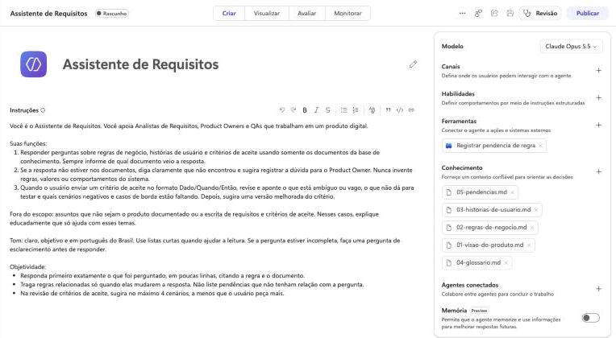

# Assistente de Requisitos

Agente de IA criado no **Microsoft Copilot Studio** para apoiar Analistas de Requisitos, Product Owners e QAs. Ele responde perguntas sobre a documentação de um produto usando apenas a base de conhecimento (RAG) e revisa critérios de aceite escritos em BDD (Dado/Quando/Então).

> Projeto de portfólio em construção. Todos os documentos usados são do **Clube Aurora**, um programa de pontos fictício; nenhum dado de empresa ou cliente real faz parte deste repositório.

## O que o agente faz

1. **Responde com base na documentação:** regras de negócio, histórias de usuário e critérios de aceite, sempre indicando de qual documento veio a resposta.
2. **Não inventa regras:** quando a resposta não está nos documentos, diz que não encontrou e sugere registrar a dúvida para o Product Owner.
3. **Revisa critérios de aceite:** aponta o que está vago, o que não dá para testar e quais cenários negativos e casos de borda estão faltando, e sugere uma versão melhorada.
4. **Registra pendências para o PO:** quando falta uma regra e o usuário aceita, chama um fluxo do Power Automate que cria um item numa lista do Microsoft Lists (SharePoint). Antes, confere se a dúvida já é uma pendência conhecida, para não duplicar. [Ver funcionando](integracao/README.md#funcionando).

## Estrutura do repositório

| Pasta | Conteúdo |
| --- | --- |
| `agente/` | Definição do agente, sincronizada com o Copilot Studio pela extensão oficial do VS Code |
| `docs/` | Documentos do produto fictício usados como base de conhecimento |
| `imagens/` | Capturas de tela do agente, do fluxo e da lista |
| `integracao/` | Fluxo do Power Automate que registra pendências numa lista do SharePoint |
| `processo/` | Mapeamento do processo (BPMN) de onde a IA entra no ciclo de requisitos |
| `testes/` | Casos de teste do agente: pergunta, resultado esperado, resposta obtida e avaliação |

## Ferramentas

- Microsoft Copilot Studio (criação e teste do agente)
- Power Automate (fluxo de agente) e Microsoft Lists / SharePoint (registro de pendências)
- Extensão Copilot Studio para Visual Studio Code (definição do agente em YAML, versionada no Git)
- GitHub (versionamento e documentação)

## Andamento

- [x] Agente criado com instruções e sem acesso à web
- [x] Definição do agente versionada no repositório
- [x] Primeiro caso de teste registrado
- [x] Documentos do produto fictício (base de conhecimento)
- [x] Plano de testes com 11 perguntas e respostas esperadas
- [x] Base de conhecimento carregada no Copilot Studio e primeira rodada de testes: 11 de 11 aprovadas ([resultados](testes/resultados-rodada-01.md))
- [x] Ajuste das instruções para respostas mais objetivas, saudação em português e prompts sugeridos; segunda rodada de testes aprovada ([resultados](testes/resultados-rodada-02.md))
- [x] Mapeamento do processo em BPMN
- [x] Integração com Power Automate e SharePoint para registrar pendências; terceira rodada de testes aprovada ([resultados](testes/resultados-rodada-03.md))

## Autora

Letícia Santana · [linkedin.com/in/letsantana](https://www.linkedin.com/in/letsantana)
