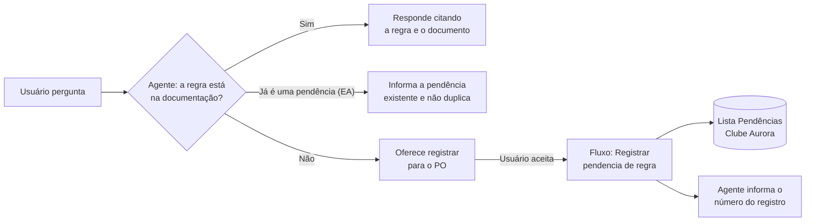
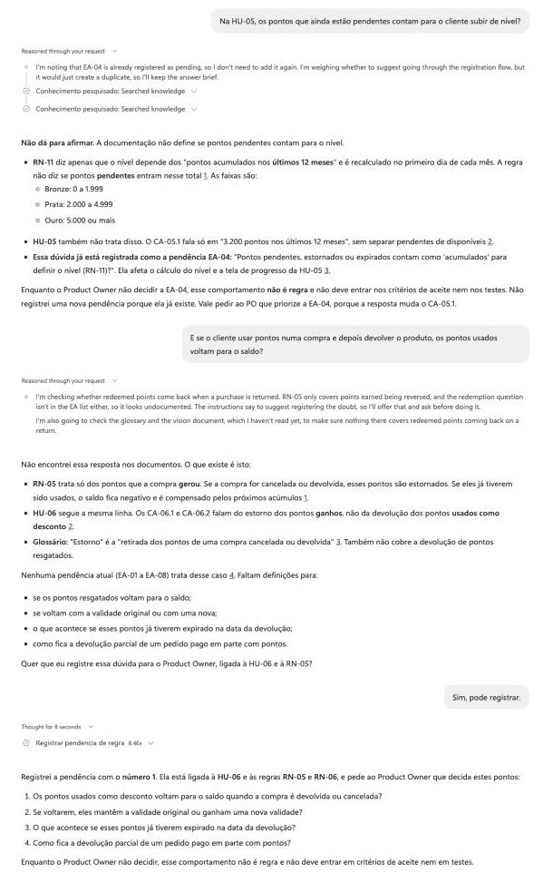
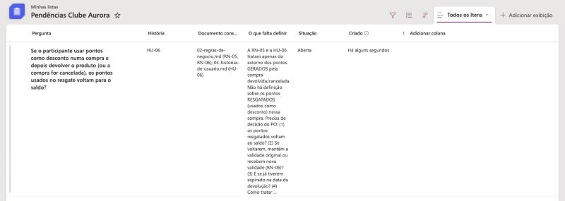
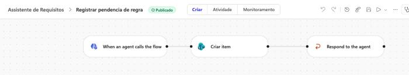
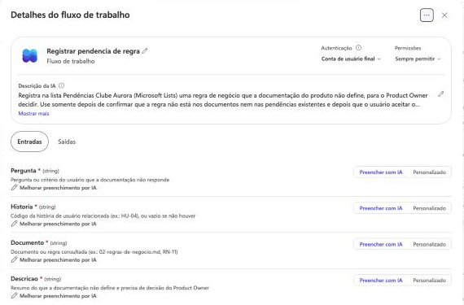

# Integração · Registro de pendências com Power Automate

Quando a documentação não define uma regra de negócio, o agente oferece registrar a dúvida para o Product Owner. Se o usuário aceitar, ele chama um fluxo do Power Automate que cria um item numa lista do Microsoft Lists (SharePoint).

É o caminho **"Falta regra de negócio"** do [mapeamento do processo](../processo/README.md), agora automatizado.

## Funcionando

Conversa no painel de teste do Copilot Studio. Na primeira pergunta, o agente reconhece que a dúvida já é a pendência EA-04 e não registra de novo. Na segunda, mostra o que a documentação diz, pergunta se pode registrar e, com o aceite, chama o fluxo.

Item criado na lista pelo fluxo:

Fluxo no Copilot Studio (Power Automate):

Ferramenta ligada ao agente, com a descrição que orienta quando usar e as entradas do fluxo:

## Componentes

| Componente | Onde fica | O que faz |
|---|---|---|
| Ferramenta do agente | Copilot Studio · Ferramentas | Descrição para a IA: registrar só depois de confirmar que a regra não está nos documentos e que o usuário aceitou |
| Fluxo de agente "Registrar pendencia de regra" | Copilot Studio · Fluxos de trabalho (Power Automate) | Gatilho "Quando um agente chama o fluxo" → SharePoint "Criar item" → "Responder ao agente" |
| Lista "Pendências Clube Aurora" | Microsoft Lists (lista pessoal da conta de teste) | Guarda as pendências para o PO decidir |

## Entradas do fluxo

| Entrada | Tipo | Preenchida pelo agente com |
|---|---|---|
| Pergunta | Texto | A dúvida do usuário que a documentação não responde |
| Historia | Texto | Código da história relacionada (ex.: HU-06) |
| Documento | Texto | Documentos e regras consultados (ex.: RN-05) |
| Descricao | Texto | Resumo do que falta definir |

**Saída:** `Registro`, com o texto "Pendência registrada na lista com o número" seguido do ID do item criado.

## Colunas da lista

| Coluna | Tipo |
|---|---|
| Pergunta (Título) | Texto |
| História | Texto |
| Documento consultado | Texto |
| O que falta definir | Várias linhas de texto |
| Situação | Escolha: Aberta (padrão) ou Decidida |

## Resultado do teste

Ver [resultados da rodada 03](../testes/resultados-rodada-03.md).
