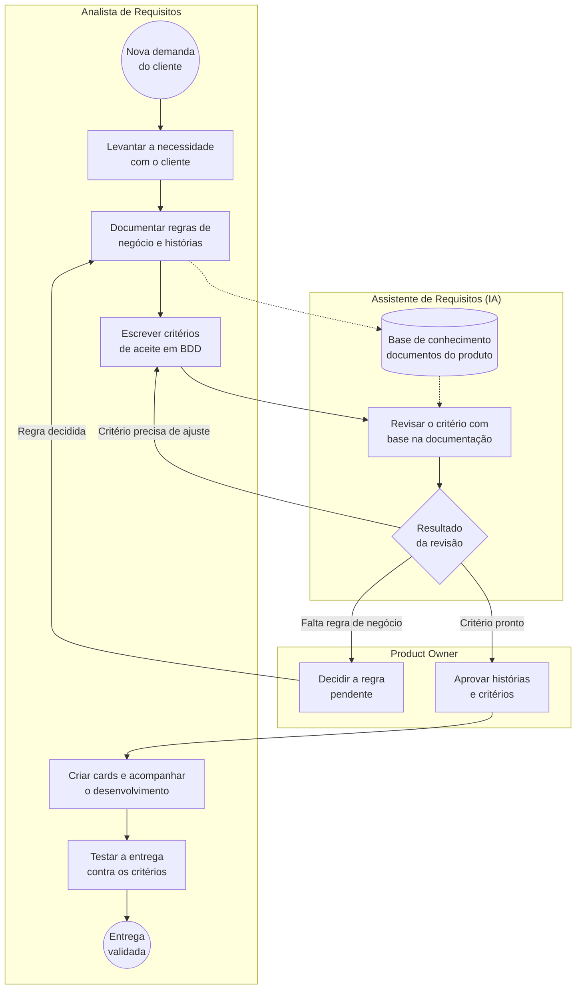

# Processo

Mapeamento em BPMN 2.0 do ciclo de requisitos com o apoio do agente de IA, usando o produto fictício Clube Aurora.

O diagrama acima é desenhado pelo próprio GitHub a partir do texto do arquivo. A versão completa em notação BPMN 2.0 está nos [arquivos](#arquivos) abaixo.

## Raias

| Raia | Papel no processo |
|---|---|
| Analista de Requisitos | Levanta a necessidade, documenta regras e histórias, escreve os critérios de aceite, cria os cards e testa a entrega |
| Assistente de Requisitos (IA) | Revisa o critério de aceite com base na documentação do produto (base de conhecimento) |
| Product Owner | Decide regras pendentes e aprova histórias e critérios |

## Fluxo

1. A demanda chega e a analista faz o discovery com o cliente.
2. As regras de negócio e as histórias são documentadas e passam a alimentar a base de conhecimento do agente.
3. A analista escreve os critérios de aceite em BDD (Dado/Quando/Então).
4. O agente revisa o critério contra a documentação. O resultado tem três caminhos:
   - **Critério precisa de ajuste:** volta para a analista reescrever.
   - **Falta regra de negócio:** vai para o PO decidir a pendência (os itens EA de [`docs/05-pendencias.md`](../docs/05-pendencias.md)); a regra decidida volta para a documentação.
   - **Critério pronto:** segue para aprovação do PO.
5. Com a aprovação, a analista cria os cards, acompanha o desenvolvimento e testa a entrega contra os critérios.

A IA apoia a revisão, mas as decisões de regra continuam com o PO e a validação final continua com a analista.

## Arquivos

| Arquivo | Conteúdo |
|---|---|
| [`ciclo-de-requisitos-com-ia.bpmn`](ciclo-de-requisitos-com-ia.bpmn) | Modelo BPMN 2.0 editável. Abre no navegador em [demo.bpmn.io](https://demo.bpmn.io) (arraste o arquivo para a página) e também no Camunda Modeler e no Bizagi |
| [`ciclo-de-requisitos-com-ia.svg`](ciclo-de-requisitos-com-ia.svg) | Imagem do diagrama em BPMN, que abre no navegador |
